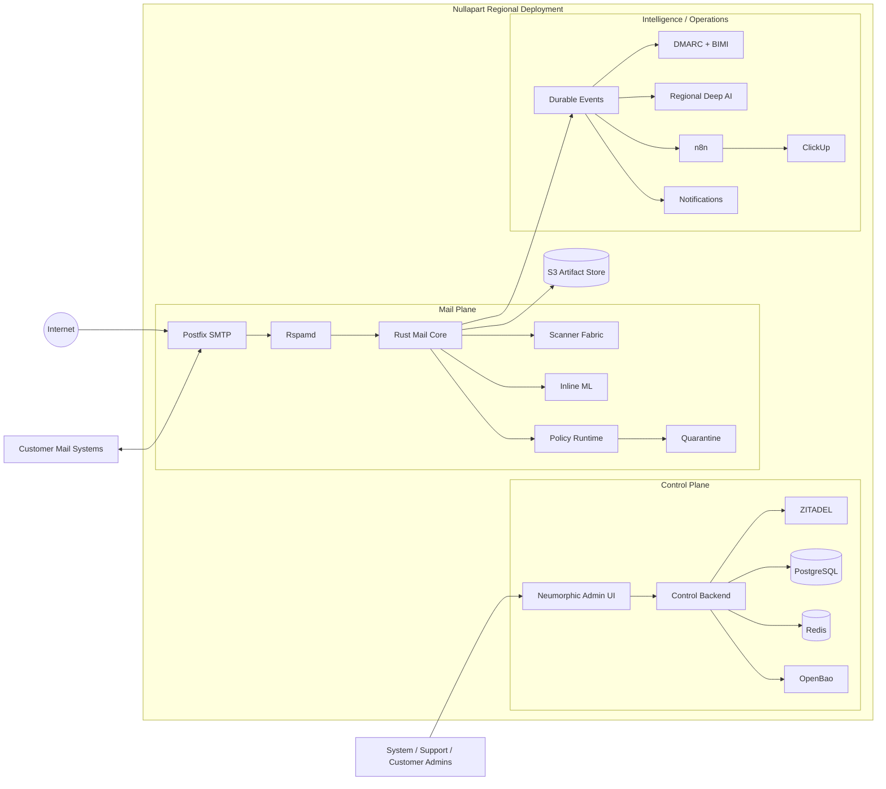
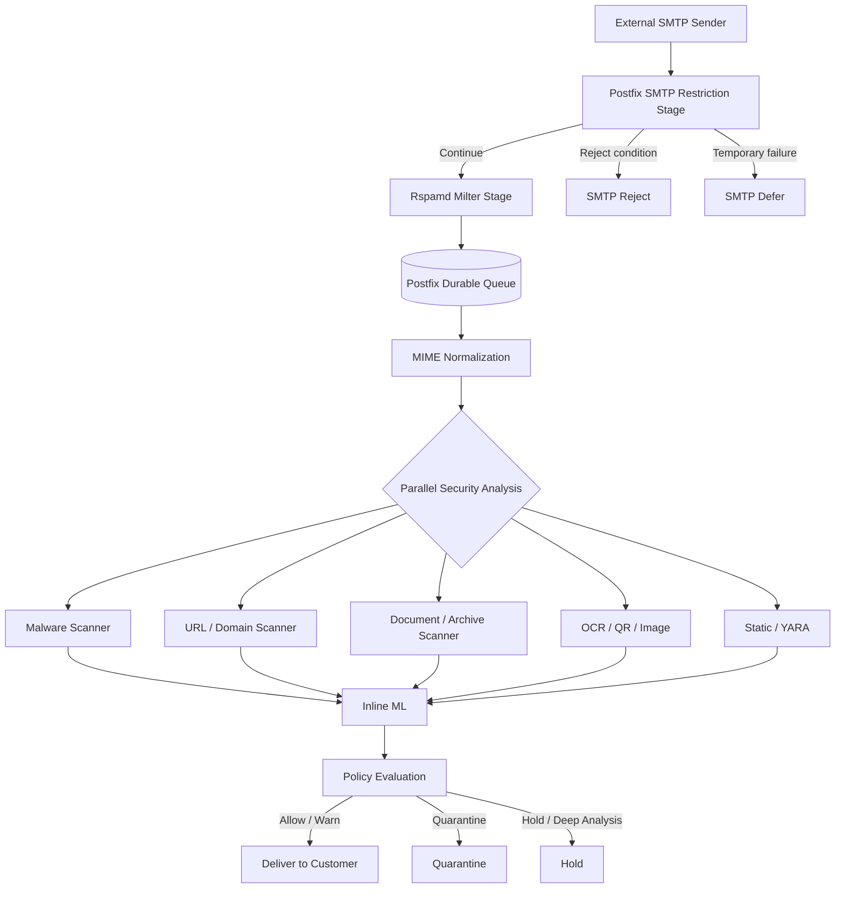
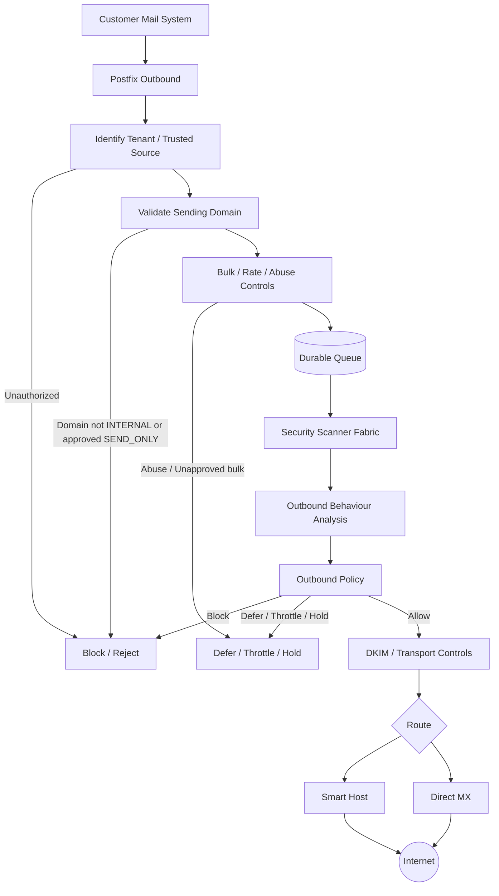
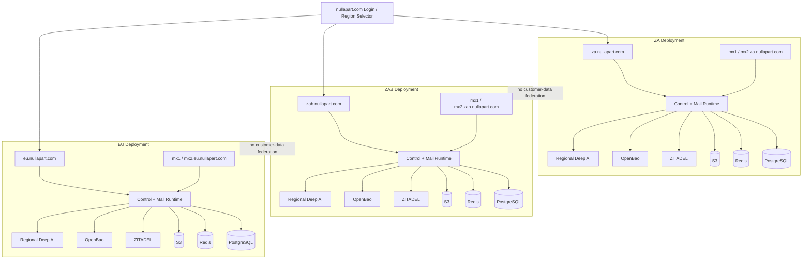
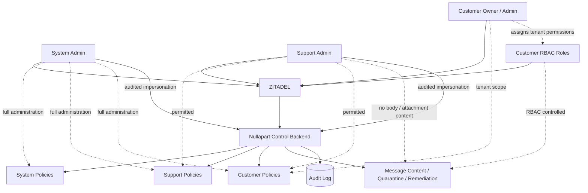
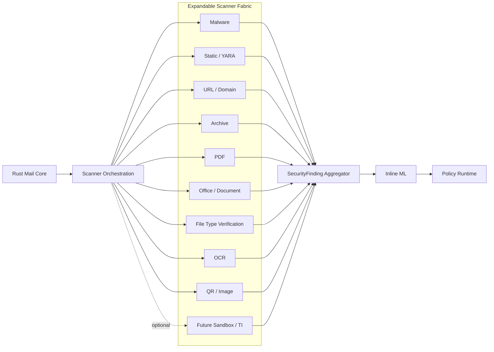
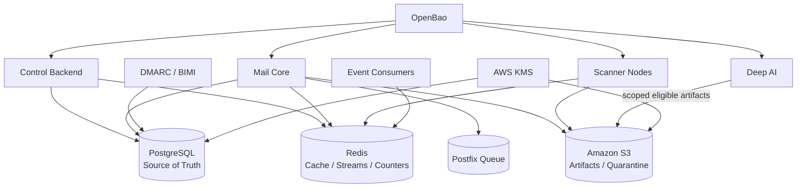
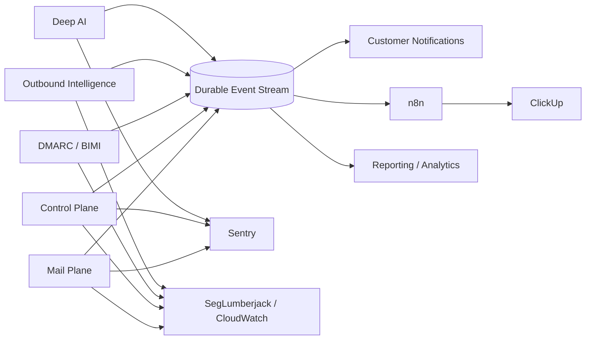
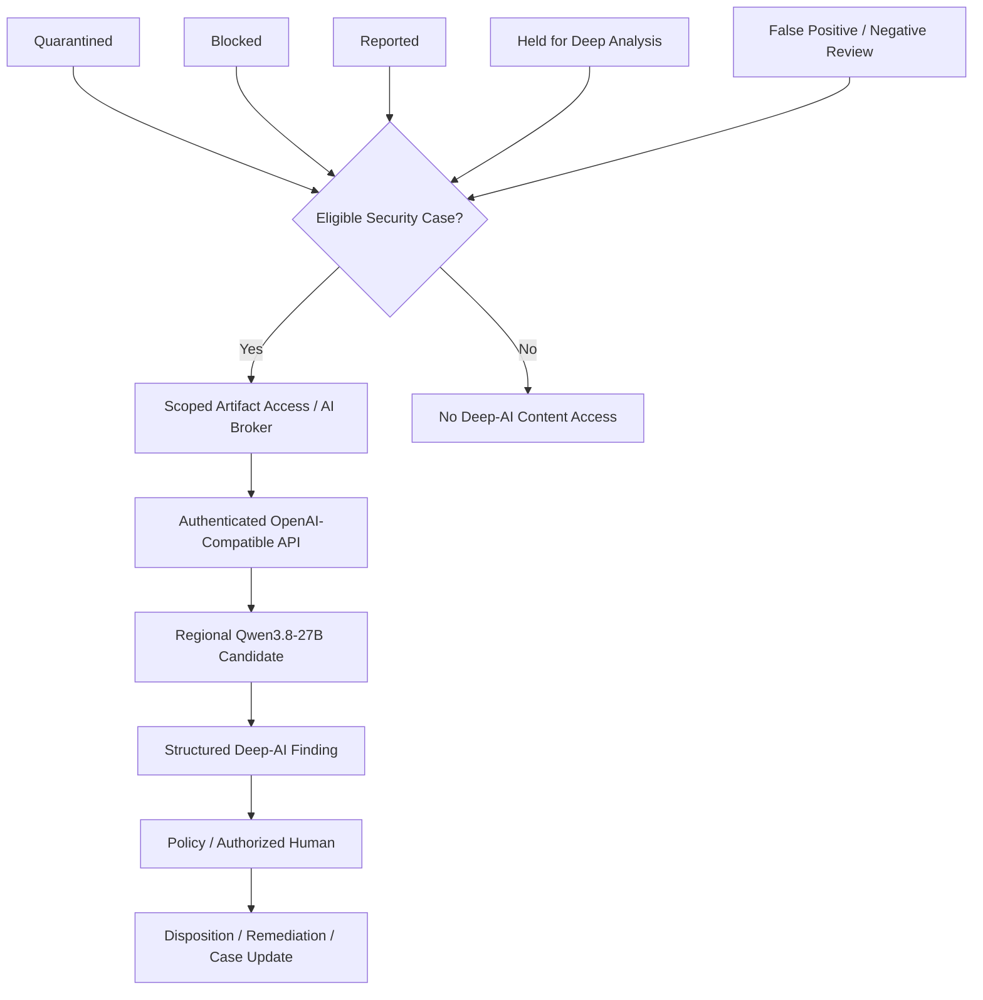
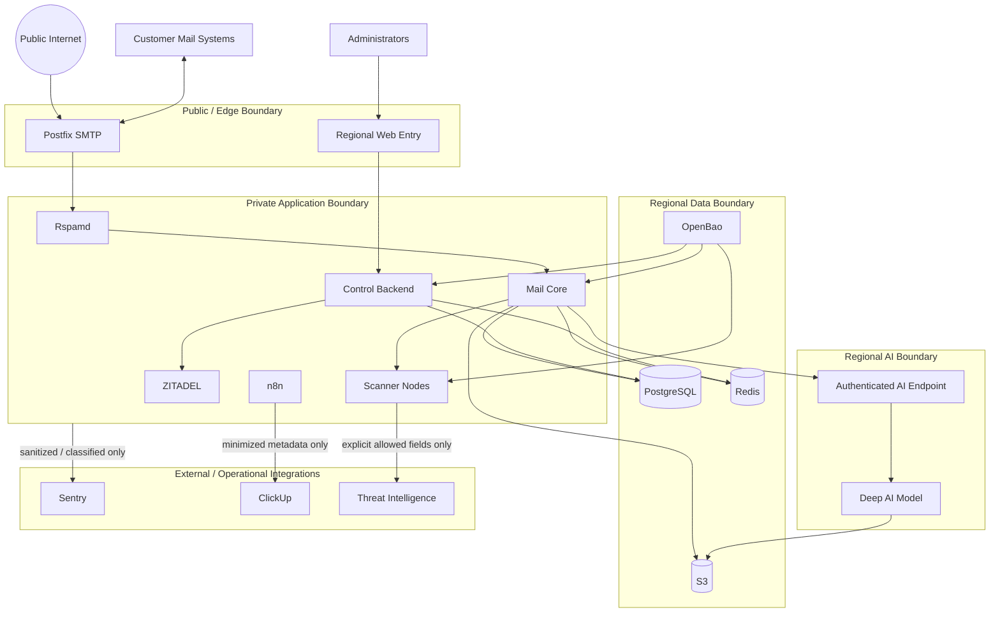

# Nullapart Architecture Diagrams

Mermaid is the canonical diagram source format for Nullapart architecture. The source files live beside this index so diagrams remain diffable and reviewable in Git.

## 1. System context

Source: [00-system-context.mmd](00-system-context.mmd)

## 2. Inbound mail flow

Source: [01-inbound-mail-flow.mmd](01-inbound-mail-flow.mmd)

## 3. Outbound mail flow

Source: [02-outbound-mail-flow.mmd](02-outbound-mail-flow.mmd)

## 4. Regional AWS topology

Source: [03-regional-aws-topology.mmd](03-regional-aws-topology.mmd)

## 5. Control-plane RBAC and impersonation

Source: [04-control-plane-rbac.mmd](04-control-plane-rbac.mmd)

## 6. Scanner fabric

Source: [05-scanner-fabric.mmd](05-scanner-fabric.mmd)

## 7. Data and storage flow

Source: [06-data-storage-flow.mmd](06-data-storage-flow.mmd)

## 8. Event and operations flow

Source: [07-event-operations-flow.mmd](07-event-operations-flow.mmd)

## 9. Deep AI flow

Source: [08-deep-ai-flow.mmd](08-deep-ai-flow.mmd)

## 10. Security trust boundaries

Source: [09-trust-boundaries.mmd](09-trust-boundaries.mmd)

## Diagram rules

- Mermaid sources are architecture artifacts and must be updated with architectural changes.
- Product-facing diagrams should avoid exposing unnecessary implementation details when used outside internal documentation.
- Security/trust-boundary diagrams must be reviewed when adding a new integration, public endpoint, scanner type, data store or cross-region flow.
- AWS-specific deployment details can evolve without changing the logical system-context diagram unless the logical trust/data boundaries change.
